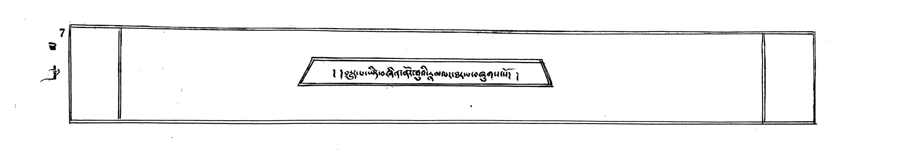
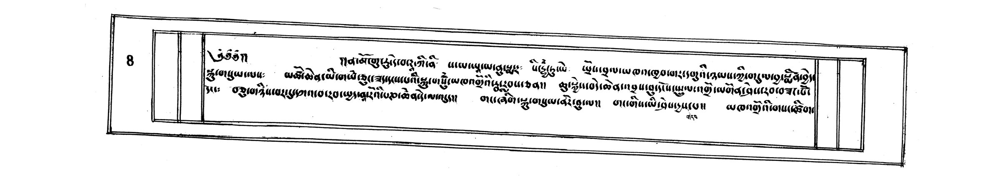
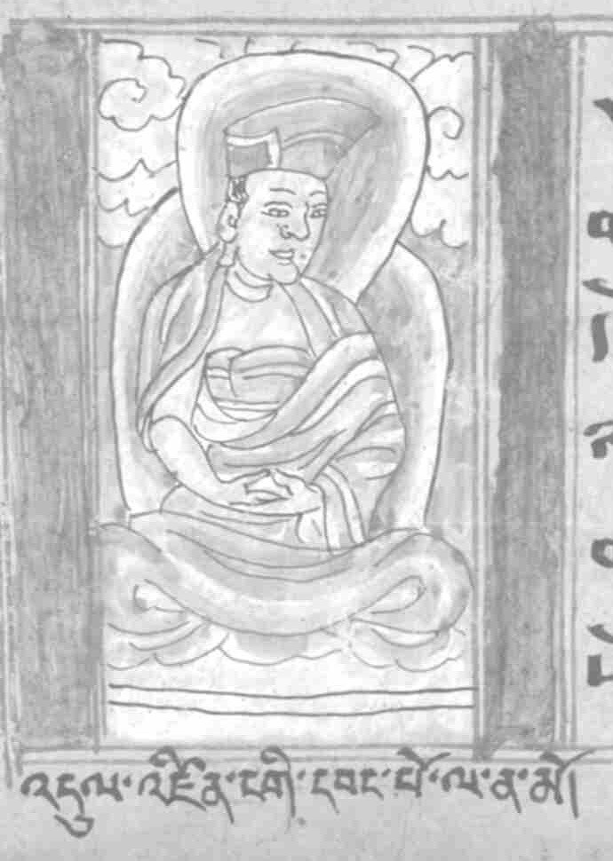
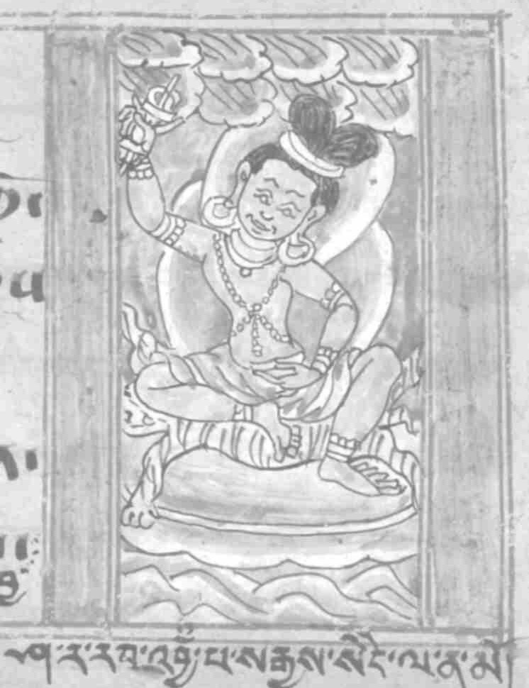
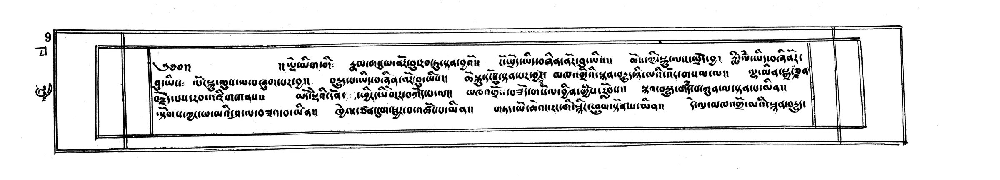
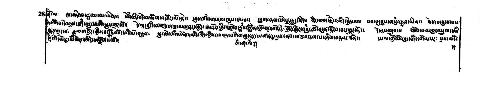

# The Life of Tilopa

© 2026 Konchok Gyurme Tenzin. Licensed [CC BY-NC-SA 4.0](https://creativecommons.org/licenses/by-nc-sa/4.0/): share and adapt it with credit, never for sale.

*Marpa Chökyi Lodrö's life of the mahāsiddha Tilopa, written for his son, translated from the manuscript kept in the library of Apho Rinpoche ([BDRC W24891](https://library.bdrc.io/show/bdr:MW24891)). [The Tibetan](tibetan.md) stands beside it, part by part, and the names are in [the glossary](glossary.md).*

*The title leaf, folio 1a: "Here is the life of the lineage, the wish-fulfilling jewel." The manuscript kept in the library of Apho Rinpoche, reprinted New Delhi, 1973 ([BDRC W24891](https://library.bdrc.io/show/bdr:MW24891), image 23).*

## 0 Homage, and the three jewels

*Folio 1b, the opening, in its double frame: the invocation and the homage (image 24).*

 

*Painted figures, a seated lama and a siddha raising a vajra, from the opening leaf of another manuscript of the same aural lineage, kept at Shechen, which begins with the same invocation ([BDRC W1KG12707](https://library.bdrc.io/show/bdr:MW1KG12707), volume 1, image 142).*

Namo guru deva ḍākinī. Samayam anusmara. Siddhyantu ye.[^invocation]

From the three bodies, beyond elaboration and wide as the sky, that ripen those to be trained in the nine moods of the dance, the three bodies like a great lake, unstirred and a little clear, whose waves are the ḍākinīs, came the lotus-born, great bliss, the fruit itself made manifest, Prajñābhadra, protector of beings. To him, and to the great paṇḍita Nāropa, who bore the twelve great hardships, I bow.

> The jewel of the three bodies,\
> sealed against all who do not know it,\
> with the key, the ḍākinīs' secret word,\
> the three jewels are shown in full:\
> by the wish-fulfilling jewel of introduction\
> the dharma body is pointed out;\
> by the wish-fulfilling jewel of dream\
> the enjoyment body is made to dwell in the body;\
> by the wish-fulfilling jewel of the lineage\
> the dharma body is shown as it is.\
> The ḍākinīs' whispered lineage, the clear light of the sun,\
> dreads to hear Rāhu the titan named;\
> yet for Dode's sake I have set it down in letters:\
> ḍākinīs, forgive me, and grant your blessing.\
> The whispered lineage's instructions are not shown to all:\
> hungry, still one does not eat one's father's and mother's flesh;\
> for gain, still one does not sell a deadly poison;\
> for a great show, still one does not put one's own heart on display.

This wondrous whispered lineage of the ḍākinīs has three parts: the marks of the master who teaches, the marks of the disciple who is taught, and the nature of the Dharma that is taught. The first: a master of the lineage, with experience and realization, and with compassion, and the rest. The second: a disciple able to seek buddhahood in his own mind in this one life and this one body, and the rest. The third, the nature of the Dharma that is taught, is in three: outwardly, the instruction of the emanation body, which clears away false notions, the wish-fulfilling jewel of the lineage; inwardly, the instruction of the enjoyment body, practiced in experience, the wish-fulfilling jewel of the path of ripening; and secretly, the instruction of the dharma body, which points out, the wish-fulfilling jewel of the path of freedom.

Of these, this is the instruction of the emanation body, the wish-fulfilling jewel of the lineage. It holds two accounts: the account of the wisdom ḍākinī of the dharma body, and the account of the lineage of the accomplished ones of the emanation body. The first: as all the buddhas dwell in three bodies, so this wisdom ḍākinī dwells in three bodies, as is told at length below. The second, the lives of the lineage of the accomplished ones of the emanation body, begins with the life of Tilo, and it has four parts: how he was known as a man; how he was known as an emanation of Cakrasaṃvara; how he was known as Cakrasaṃvara himself; and how he was known as the body in which all the buddhas gather.

*Folio 2a, the second leaf of the manuscript, still in its frame, opening "the key of the ḍākinīs' secret word" (image 25).*

## 1 Tilopa as a man

First, taken as a man, the great lord Tilopa's great qualities are four: first, in the provisional sense, how the ḍākinīs foretold him, and he sought a guru and practiced; how he overwhelmed the ḍākinīs and asked them for the Dharma; how, in the definitive sense, he was shown to have no human guru; and how he showed his manifold emanations.

## 1.1 The boy who herded buffalo

First, Tilopa. In the east of India, in the land of Zahor, in a city called Dzako, there lived three: the father, the Brahmin Salwa; the mother, the Brahmin Salden; and the sister, the Brahmin Saldrön. They had no son, and when they had made offerings to every shrine, outer and inner, and prayed, a son was born. At that moment the whole east of India was filled with light, so he was named Salö, Clear Light. Then they asked a Brahmin who read the marks, and he said:

> Whether he is a god, a nāga or a yakṣa,\
> or a buddha, I cannot tell:\
> cherish this holy being and guard him.

As he said, they cherished him and guarded him. Once, when the father had gone out and mother and son were alone, something flickered, and when they looked, there were many ugly women with the marks, puffing out their breath, limping and leaning on sticks. The mother thought, "Are they demons? Will my boy die?" and the women said:

> Cherish him and guard him as you may,\
> there is no land on earth where none must die.

So they said. His mother asked, "Then what can we do that will help?" and they said again:

> Let the boy herd buffalo and learn his letters:\
> a ḍākinī's prophecy will come.

With that, they say, they vanished without a trace.

Then, when he had grown up and they had set him to do so, he was herding the buffalo when the women from before came again and asked about his country, his father and mother and the rest, and the boy said:

> My country is Dzako, in the east;\
> my father is Salwa, a Brahmin;\
> my mother is Salden, a Brahmin;\
> my sister is Saldrön, a Brahmin;\
> and I myself am Salö, a Brahmin.\
> This tree is a sal tree.[^sal]\
> I have learned my letters, and I practice the holy Dharma;\
> I herd the buffalo for our wealth.

When he said this, the women, as though they were angry, said, "Child, you do not know:

> your country is Oḍḍiyāna, in the west;\
> your father is Cakrasaṃvara;\
> your mother is Vajravārāhī;\
> your sister is the ḍākinī Giver of Bliss;\
> you yourself are Pañcapana.[^pancapana]\
> Do not herd the beast, the buffalo:\
> in the forest of the tree of awakening\
> herd always the buffalo of experience."

So they said. The boy said, "I do not know how to herd that," and they said, "Go to the charnel ground of Sala Bhehara. A guru will show you." So they foretold.

In the southern lands there is a charnel ground called Sala Bhehara, blessed by Maheśvara. When the outer and inner ḍākinīs were turning the wheel of the feast there, the Brahmin's boy came, and he asked Caryāpa for instruction too.

The great master Lawapa sang:

> At the crossroads of a great city\
> I slept for twelve years\
> and won the siddhi of Mahāmudrā.

When he said this, the boy asked him for luminosity.

He looked for Nāgārjuna. In that charnel ground, in an outcaste's hut, a yogin who kept the yogin's discipline sat meditating. "Nāgārjuna has gone to teach the Dharma to the king of the gandharvas," he said. "I have been sent to take you into my care, good man." The boy offered him a maṇḍala and asked, and he called up before him the maṇḍala of glorious Guhyasamāja, gave him its empowerment and explained its tantra, and the boy saw the nature of mind.

In a temple there, where his uncle was reciting the Perfection of Wisdom in a Hundred Thousand Lines, a woman came and said, "Do you know what this means?" He said he did not. "Then I will explain it," she said, and she explained its meaning. She gave him the empowerments of Hevajra and Cakrasaṃvara and explained their tantras. "This is what Lūhipa meant," she said. "Meditate on it." When he said, "My uncle keeps me at the Hundred Thousand and will not let me meditate," she said, "Cut the cord that binds the Hundred Thousand, throw it from the temple door into the water, put on the guise of a madman and meditate. I will bless it, and nothing at all will befall the Hundred Thousand." He did as she said, and nothing at all befell the Hundred Thousand.[^hundred] "He has gone mad," they said, and they locked him up. There he trained in the two stages, the essence of all the paths that shine clearly in the undivided mind of the Sugatas.

Then came a prophecy:

> In the east, in the land of Bengal,\
> in the market of Pañcapana,\
> become the servant of Bharima the harlot\
> and her household, and you will be made clean:\
> bring the conduct to its end, and win accomplishment.

So it was foretold, and he went there. By night he did the work of bringing men in and seeing them out; by day he did the work of pounding sesame, so that in the language of India he was known as Tilopa, and in Tibetan as Til Sungzhab, the Sesame Keeper.

Then he went to the charnel ground called Kereli, where he and Bharima delighted each other in the conduct of the secret mantra, and brought it to its end.

Then, back in that market, as he went on pounding sesame, he won the accomplishment that is close to the supreme Mahāmudrā. The people of the city saw him in different ways: some saw a blazing mass of fire, and some saw fire blazing in his bone ornaments. They asked him for instruction, and he said, "Let the innate that has arisen in my mind enter the hearts of you who follow me," and at once they were freed.

Then the king of that country came riding an elephant with his court to honor them, and the Brahmin's boy and Bharima, the two of them, sang a vajra song in a great voice like Brahmā's:

> Sesame oil, the essence that lies within it:\
> the dull may know that it is in the seed,\
> but if they do not know the links of dependent arising\
> they cannot bring the essence, the oil, out.\
> Just so the innate, primordial wisdom,\
> though it is in the heart of every being,\
> cannot be realized unless the guru points it out.\
> When the sesame is pounded and the husk is cleared away,\
> the essence, the oil, comes out; just so,\
> relying on the guru, the meaning of suchness\
> is shown in signs, as the oil of the sesame is.\
> All things become one nature, not divided.\
> Kye ho! The meaning far off and hard to fathom\
> is clear right now. What a wonder!

When they had sung this, all who were gathered there were freed. The meaning of the song, untied: there is nothing out of keeping with the meaning to give up, no remedy, wisdom, to bring about, no grounds and paths to travel, no fruit to gain; only as a convention, in signs, must the guru show it. That is what it means. Then they asked him who his guru was, and he said:

> I have human gurus:\
> Nāgārjuna, Caryāpa, Lawapa,\
> and Kalpa Zangmo; these are mine,\
> the gurus of the four transmissions.

So he said. From Nāgārjuna he asked for the illusory body, from Caryāpa for dream, from Lawapa for luminosity, and from the ḍākinī for inner heat; and these are known as the four great rivers of the whispered lineage.

## 1.2 The ḍākinīs brought under his power, and the jewels asked for

Second, how he brought the ḍākinīs under his power and asked them for the Dharma. Again the women came and said:

> The whispered lineage without letters\
> is kept by the stainless ḍākinīs:\
> receive the three wish-fulfilling jewels.

When they said this, he said, "I cannot receive them," and again the women said:

> At Gandhola in the land of Oḍḍiyāna\
> one foretold and true to the pledge,\
> one with the fortune to take them, receives them.

When they said this, he asked what he must do to receive them, and they told him, "Take a crystal ladder, a bridge of jewels and a pair of grass mice, and go to Oḍḍiyāna."[^ladder] His father found these without trouble, and he took them and went.

Now in the land of Oḍḍiyāna in the west, in the temple of Gandhola, dwells the one called the ḍākinī of wisdom, the dharma body: in the state where reference has ceased, in non-duality, dwelling in the manner of not dwelling, she dwells as a queen. Beside her is the one called the ḍākinī of the five families, the enjoyment body: in a palace of jewels she keeps the three precious wish-fulfilling jewels hidden, locked in with indestructible iron and sealed with seven seals, and ringed by a fortress, a moat and an iron wall, she dwells as a minister. Beside her is the emanation body, the ḍākinī of action, the devourer: to those with faith and devotion she gives siddhis, and those without faith, and those whose pledges are broken, she cuts down and devours; she dwells as a gatekeeper. The Brahmin's boy went to the temple of Gandhola in the land of Oḍḍiyāna in the west, and the emanation body, the ḍākinī of action, came at him with a voice to crack the earth, a voice like thunder in the sky:

> I am the ḍākinī of action, the emanation body:\
> I delight in human flesh and lust for blood.

So saying, she came at him, and the Brahmin's boy said:

> Many ḍākinīs, most terrible,\
> cannot stir the tip of one hair of mine.

So he said, and he overwhelmed them with the discipline of awareness. His body did not move, his speech did not falter, his mind did not shrink, and he gazed at them; and the ḍākinīs swooned. When they came round from the swoon, they said:

> Kye ma! As the moth is destroyed by the lamp,\
> wanting to eat you, we are undone.\
> Holy one, do with us as you please.

So they said. Then the Brahmin's boy said, "Let me in," and the ḍākinīs said:

> We are like servants and have little power;\
> unless we have asked the ministers,\
> we are eaters of flesh and drinkers of blood:\
> holy one, take this to heart.

They handed him over to the ḍākinīs of the enjoyment body. These said, "Your discipline looks slight. We will set you free: go up." The Brahmin's boy laid the bridge of jewels across the moat, set the crystal ladder against the iron wall, opened the gate with the pair of grass mice and went in, and the ministers said:

> Terrible in body, terrible in speech,\
> bearing terrible weapons as well,\
> we are the ḍākinīs of the five families, the enjoyment body:\
> we delight in flesh and lust for blood.

So they said, and again the Brahmin's boy said:

> Many ḍākinīs, most terrible,\
> cannot stir one pore of my body's hair.

So he said, and he gazed at them, and they swooned. "Let me in," he said, and the ministers said:

> We are like ministers and have little power;\
> unless we have asked the queen herself,\
> we are cut down by her decree:\
> holy one, take this to heart.

So they said, and they prayed to the ḍākinī of the dharma body, and the boy went in. The wisdom ḍākinī of the dharma body sat ringed by heroes past counting in a row on her right and heroines in a row on her left, and the Brahmin's boy did not bow to her, and her retinue said:

> This one, before her who of all the buddhas\
> is the mother, the Blessed Lady,\
> shows no respect: why not crush him?

So saying, they set about destroying him, and then the ḍākinī of the dharma body spoke to her retinue:

> This one, of all the buddhas\
> the father, is Cakrasaṃvara:\
> though you rained vajras down from the sky,\
> how could you overcome him now?

So she said, and the retinue, as though they did not know the boy was Cakrasaṃvara, said, "Who sent you? Who are you? What do you want?" and the Brahmin's boy said:

> I am Pañcapana;\
> my sister, the Giver of Bliss, has sent me;\
> with view, conduct, fruit and pledge\
> I have come to take the jewels of the three bodies.

When he said this, the retinue laughed him to scorn and said with one voice:

> The blind look and see no form,\
> the deaf listen and hear no sound,\
> the mute speak and no one grasps the meaning:\
> deceived by a demon, there is no truth in it.

To this the master answered:

> One whose faults are spent\
> has no cause to speak false words:\
> no demon, it is the ḍākinī, truly.

When he said this, the wisdom ḍākinī gave the signs of the precious jewel: of her body, a painted card; of her speech, a seed syllable; of her mind, a hand emblem. And the Brahmin's boy said:

> From the secret treasury of the body, appearance and emptiness,\
> I ask for the common wish-fulfilling jewel;\
> from the secret treasury of speech, beyond words,\
> I ask for the wish-fulfilling jewel of the pledge;\
> from the secret treasury of mind, free of thought,\
> I ask for the wish-fulfilling jewel of the way things are.

When he said this, the wisdom ḍākinī said:

> For the common wish-fulfilling jewel\
> the foretold key of experience is needed:\
> unforetold, it will not open.\
> For the wish-fulfilling jewel of the pledge\
> the key of the profound lineage of the word is needed:\
> without the remedy, it will not open.\
> For the wish-fulfilling jewel of the way things are\
> the key of profound wisdom is needed:\
> without realization it will not open.

So she said, and the Brahmin's boy said:

> The ḍākinīs' secret word is sealed by the heart:\
> the lamp of wisdom that clears the dark of ignorance,\
> self-aware, self-arisen, self-illumined:\
> I have the foretold key of experience.\
> In mind itself, which nowhere arises,\
> self-freed, the dharma body,\
> self-freed, it dawns as Mahāmudrā:\
> I have the key of the pledge, self-freed.\
> Taking no object to mind,\
> no mote of thought arising,\
> in mind itself, the nature of things, the dharma body,\
> I have the key of experience that sees.

So he said, and the wisdom ḍākinīs of the enjoyment body and the emanation body, both together, sang this song with one voice:

> Our one father, the Blessed One,\
> Tilo, the buddha, protector of beings,\
> Cakrasaṃvara, great bliss:\
> to you we offer the three wish-fulfilling jewels.

So saying, they gave him the root tantra in fifty-one chapters with its explanatory tantras, and the whispered lineage. And from the mouth of the ḍākinī of wisdom came this: "If you would accomplish my body, strive in the stage of generation; my speech, in the essence; my mind, in the stage of completion, Mahāmudrā. Go to the monastery of the Crown Jewel, and take Nāro, Riri and Kasori into your care."

With that the chief lady vanished. He was given the name Tilo Prajñābhadra, and he said:

> Like a bird in the sky,\
> the bird of luminous mind takes wing:\
> Prajñābhadra goes, unhindered.

When he said this, the ḍākinīs of the enjoyment body and the emanation body said:

> Holy one, what are you like?\
> We beg you to stay for our sake.

When they asked this, Tilo said:

> As the chief lady herself foretold,\
> for the sake of worthy vessels, I, the yogin,\
> go to the monastery of the Crown Jewel.

So he said, and on the road as he went, the nine cycles of the teaching of the bodiless ḍākinīs were given him out of the sky:

> The vajra speech of the bodiless ḍākinīs,\
> like the sweet songs of the gandharvas,\
> was heard thus from the empty sky:\
> Ripening and freeing, undo the knot of mind.\
> The pledge: look into the mirror of your own mind.\
> Turn the wheel, the lattice of channels and winds.\
> Hold the precious jewel of great bliss, of speech.\
> Look at the lamp of awareness, of wisdom.\
> Look at self-freed Mahāmudrā.\
> The sacred substance: the sun of realization, the key.\
> Conduct: strike the water with a sword.\
> One taste: look into the outer mirror.

He heard these from the sky, and Tilo said:

> As the chief lady showed the way,\
> in Gandhola, the illusory body,\
> I have taken in the secret of the bodiless ḍākinīs\
> and locked it with speech beyond words:\
> the bird of luminous mind flies off.

So saying, he went to the temple of Aḍona, the monastery of the Crown Jewel.

## 1.3 No human guru

Third, that he had no human guru. Many people gathered there, and since he had gained accomplishment and received the Dharma at Gandhola, they asked him who his guru was:

> I have no human guru:\
> my guru is the All-Knowing.

So he said.

## 1.4 The eight tamings

Fourth, how he showed his manifold emanations. There are eight: he overwhelmed the yogin, and he tamed the heretic, the magician, the beer-seller, the singer, the butcher, the one who says acts bear no fruit, and the great sorcerer.[^order]

### 1.4.1 The yogin

First. In the south of India there was a king who loved his mother dearly and did whatever pleased her. "What good deed would please you?" he asked her. "I will do it." His mother said, "I would be glad if you gathered paṇḍitas, siddhas and ḍākinīs, raised a maṇḍala of jewels in the sky, and held a great empowerment and a feast." So he sent a runner to each of the paṇḍitas who could do it, and one runner to the siddhas, and invited the paṇḍitas and the siddhas. The paṇḍitas performed the rite of the ground and the rest, and it was proclaimed that whatever these did would succeed. Then an ugly woman with the marks came before the kusālis and said, "Who will be the master of your feast?" The Unrivaled said, "I will." "You will not do," she said. "My brother will." When they asked where he was, she said, "In the charnel ground." "Then go and fetch him," they said, and she went to fetch him and said that he would come. At the very end he came, and he sat with the Unrivaled on two thrones. They debated the logic that shows the contradictions and connections of word and meaning, and they were equal. They drew maṇḍalas in the sky and took turns making them vanish with rain and wind, and they were equal. They rode lions in a race to the sun and the moon, and again they were equal. Then Tilo brought the sun and the moon down to the ground and rode a lion on them; he turned his body inside out, and on each hair he called up a maṇḍala with its charnel ground, and in each charnel ground a tree, and in each tree he sat cross-legged at play; and the Unrivaled could not do it. All were amazed. "E ma! From what does such magic come?

> From what does such wondrous conduct come?"

When they said this, he answered in song:

> Kye ma! When I sit, I sit in the midst of the sky;\
> when I lie down, I lie on the point of a spear;\
> when I look, I look into the heart of the sun and moon.\
> I am Tilopa, who has realized the ultimate:\
> I am free of all striving.

So he said, and when he spoke of the nature beyond thought, all were freed. The yogin was given the name Mighty Intellect, and even now he lives in Oḍḍiyāna without passing away.

### 1.4.2 The heretic

Second, the taming of the heretic. At glorious Śrī Nālandā there was a heretic teacher, a siddha, before whom all, outsiders and insiders, had always to rise; whoever did not had to vie with him in power and in debate. Tilopa did not rise, and he said, "You seem to think yourself something in power and in debate. Let us vie." They set the king as judge, and all the paṇḍitas, outsiders and insiders, gathered on the terms that whoever lost would enter the teaching of the one who won. In debate the heretic was defeated. Vying in power, he could not prevail against Tilopa either, and the heretic sent fire out of his mouth and said:

> I who shake all three realms,\
> who is there that does not fear me?

When he said this, Tilopa turned it back and answered in song:

> If you would look, look with a blind man's eyes;\
> if you thirst, drink the water of a mirage;\
> if you sink, fill the vase with wind:\
> Tilo is free of every fear.

So he said, and when he spoke of the nature of things beyond thought, all were freed. The heretic was given the name Black Virtue, and even now he lives in the Cool Grove without passing away.

### 1.4.3 The magician

Third, the taming of the magician. A magician was taking the king's country with an army of illusion. An ugly woman with the marks came and asked the king, "Who will be your general?" "This one and that one," he said. "They will not do," she said. "My brother will." "Where is your brother?" "In the charnel ground, on a sal tree a league high, he has tied a horse's tail; to it he has tied a corpse's legs; to its arms he has tied five horses; and he holds on to them and dances." So she said. When they told the king, he said, "That woman has spoken of three things that cannot be. Bring her here," and when they asked her, she said just what she had said before. He sent men to look, and it was as she had said. Then they invited Tilopa. Not knowing the army for an illusion, they were on the point of being routed, when he broke the illusion, killed some, and seized the magician. The magician said:

> You, a man who relies on the Dharma,\
> how can it be right to kill like that?

When he said this, Tilopa answered in song:

> In killing an army of illusion,\
> since it has no mind, there is no sin.\
> If you would kill, kill the man of illusion;\
> if you would meditate, meditate as one without breath;\
> if you would speak, speak with a mute's tongue;\
> if you would desire, take the letters to their end.

So he said, and when he spoke of things beyond thought, all were freed. The magician was given the name Deceiver Who Tells the Truth, and even now he lives at Aṭṭahāsa without passing away.[^magician]

### 1.4.4 The beer-seller

Fourth, the taming of the beer-seller. Once, when a woman who sold beer was selling her beer, a monkey and a cat that Tilo had sent forth drank her beer on credit, and she wept. People asked what was wrong, and she told them the tale. They said, "Pray to that yogin himself," and the beer-seller wept and said:

> My living is cut off:\
> in your compassion, take me into your care.

When she said this, in an instant he filled every jar of beer with beer, and sang a song:

> If you thirst, drink the boiling water of poison;\
> if you stray, chase the monkey and kill it;\
> for a remedy, rely on the great meditator, the cat;\
> turn everything into the one taste of the innate.\
> I am Tilopa, beggar of the ultimate,\
> a yogin you have never seen.

So he said, and when he spoke of great bliss beyond thought, all were freed. The beer-seller was given the name Sunlight Lamp, and even now she lives on the island of Sosa without passing away.[^ifyou]

### 1.4.5 The singer

Fifth, the taming of the singer. There was a skilled singer. Before him Tilopa sang a song of his own making. "Will you compete?" the singer asked. "Let us compete," he said, and the singer said, "Master, take up a song." "I will sing after," said Tilopa. The singer sang his song through to its end; then the master sang, and his song had no end, and the singer could not match him. He said:

> I am a singer who puts even\
> the world of Brahmā to shame.

When he said this, Tilopa answered in song:

> If you grieve, look at the city of the gandharvas;\
> if you listen, listen to the song of the bees;\
> if you look, look with a blind man's eyes:\
> all that is heard is like an echo.

So he said, and when he spoke of music beyond thought, all were freed. The singer was given the name Melodious Mute, and even now he lives in Nagara without passing away.[^singer]

### 1.4.6 The butcher

Sixth, the taming of the butcher. A butcher, who had killed all the young of living beings, was raising one son of his own. When he had cooked the meat and opened the carcass, meaning to give it to his son, Tilo made it appear to him as his own son's legs and arms. The butcher said:

> The sin I have done myself,\
> has it come round on me, or what is this?

He was tormented with grief, and Tilopa said, "Then if you kill no others, your own son will come back." "I will not kill," he said, and Tilopa answered in song:

> If you would open, open the heart of the clear oil;\
> if you would burn, burn with the fire at the end of time;\
> if you would draw out, draw the wind-mind out through the crown;\
> if you would wash, wash away the stains of mind.

So he said, and when he spoke of the practice of killing beyond thought, all were freed. The butcher was given the name Bliss-Making Joy, and even now he lives on the island of the rākṣasas without passing away.[^butcher]

### 1.4.7 The one who said acts bear no fruit

Seventh, the taming of the one who held that acts bear no fruit. A Cārvāka, who denied cause and fruit, said there is neither virtue nor sin; the Buddhists said there is; and they made the master the judge of their debate. The master said, "Those who hold that acts have causes and fruits win." The Cārvāka said, "No one has seen it with his eyes." So the master led him off and showed him, by emanation, the gods and the hells and all the rest. In one heaven there was a goddess without a mate, and when he asked what she was, they said, "Some heretic is doing virtue; she is to be his companion." Then he led him to hell, and in every copper cauldron something was boiling; one had nothing in it, and when he asked what was to be boiled there, they said, "All the heretics who say there is neither virtue nor sin are boiled here," and he was terrified, they say. He said:

> By the sin heaped up by acts,\
> hell circles in one's own mind;\
> by the virtue heaped up by acts,\
> the higher realms circle in one's own mind.

When he said this, the master answered in song:

> If you cling, go off to the island of charnel grounds;\
> if you are low, turn to the top of the victory banner.\
> Discursive thought is the emanation body:\
> I have nothing at all to teach.

So he said, and when he spoke of the manifold beyond thought, all were freed. The Cārvāka was given the name Jinabodhi, and even now he lives on Śrīparvata without passing away.

Besides these, by the bearing of his body he taught the Dharma to sinners: to a craftsman as a craftsman skilled in craft, to a meditator as one accomplished, and so to fishermen and dog keepers and others without number. They told him that they were fishermen and the like, and when they had told him, they said:

> Tilopa, who has realized the ultimate,\
> for you there is not even a name for virtue and sin.

So they said, and they asked him for instruction.

### 1.4.8 The sorcerer

Eighth, the taming of the sorcerer. A sorcerer had been killing everyone with his black magic, and Tilo saw that the time had come to tame him. The two vied in cutting down, and they were equal; but of all who died, Tilo took up the dead, and some, the women and others, he did not take. He made the sorcerer himself like an old tree stump, and said, "Now, if I raise your women up, will you give up your magic?" The sorcerer could not bear it and said:[^sorcerer]

> This conduct, from which no one recovers,\
> is it any different from a butcher's?

When he said this, Tilopa answered in song:

> Look, look into your own mind:\
> swallow the mountain of appearances in one gulp;\
> drink the great ocean down in one draught;\
> cut the tether of saṃsāra and let it lie.

So he said, and when he spoke of activity beyond thought, all were freed. The sorcerer was given the name Nyiimi, and even now he lives at Kimitsikili.

## 2 An emanation of Cakrasaṃvara

The second general part: how he was shown to be an emanation of Cakrasaṃvara. In the east of India, on the bank of the Dukata, at the source of the river Khasu, in the charnel ground of the Masha Grove, there is a monastery called Sorrowless. There Tilopa's uncle and his mother, who was a nun, were his abbot and master, and there he was ordained as a monk and named Kalapa. The others gave themselves to the three wheels of a monk's work, but he did not keep the Dharma: he killed many small birds and showed his head one way and his body another, and everyone mocked him. Now those in charge of discipline took counsel, and the provost, with the followers of the Dharma in general and the monks in particular, called an assembly of the Sorrowless monastery and brought him to account, and the king of that country said:[^birds]

> You, in a monk's form, killing living things:\
> what is your country, who are your abbot and master?

When he asked this, Tilopa answered in song:

> Sorrowless is my monastery;\
> my abbot and master are my mother and my uncle;\
> I myself am Tilo, the monk.\
> For ten million kalpas I\
> have gone to a hundred buddha fields;\
> with Nāgārjuna and Āryadeva\
> and with the buddhas I have talked;\
> I have seen a thousand buddhas;\
> I have killed no living thing.

When he said this, the birds, they say, flew up with a whir and were gone, and all believed, and he was known as an emanation of Cakrasaṃvara.

## 3 Cakrasaṃvara himself

Third, how he was held to be Cakrasaṃvara himself. He went begging for alms in the east of India: going out he set his feet down slowly, his eyes looked no farther than a yoke's length ahead, and he recited verses of poetry; coming back he spoke the blessings of giving and receiving; and the people grew devoted to him. The king of that country invited them all and honored them, and the king said, "Let each of you bring forth a verse on giving and receiving that does not go against the grammar of the grammarians, nor against logic, scripture, instruction, experience, or the realization of those who have realized." They all did so, and each agreed with one side or two. When his turn came the master spoke, and it went against none of them and reached the final meaning of each, and the king wrote it down:

> I have no father or mother:\
> Cakrasaṃvara, the supreme of bliss.\
> I have no abbot or master:\
> I am a self-arisen buddha.\
> I have no grammar or logic:\
> reasoning breaks out of awareness by itself.\
> Saṃvara's body, speech and mind\
> and my body, speech and mind are not divided:\
> I go into great bliss.

So he said, and he was known as Cakrasaṃvara himself.

## 4 The body of all the buddhas

Fourth, how he was shown to be the body in which all the buddhas of the three times gather. King Siṃhacandra invited many siddhas, honored them, and asked for empowerment. Tilopa raised a maṇḍala of colored powders in the sky, and each saw it differently, and Tilo sang a song:

> My body is Hevajra,\
> my speech is Mahāmāyā,\
> my mind is Cakrasaṃvara,\
> my aggregates and elements, Guhyasamāja,\
> my limbs, the Black One, the tantra of sound,\
> my lesser limbs, Vajrabhairava,\
> my body's hairs, the buddhas of the three times.

So he said, and Tilopa was known as the body in which all the buddhas gather.

By such deeds, at the end, he set the beings of Zahor in the east on the path of ripening and freedom, and a city of seven hundred thousand was emptied.

So ends the life of Tilopa, lord of yogins, whom even the accomplished know as an emanation body: the account of what he did by his own great qualities, told as it is and told in full.

Written down at the monastery of glorious Drowolung for my son Dode. It is complete. Maṅgalam.[^colophon]

*Folio 11b, the last leaf: Marpa's colophon, written at Drowolung for his son Dode, closing "Maṅgalam" (image 44).*

## Notes

[^invocation]: The invocation is in Sanskrit, as the Tibetan writes it: "Homage to the guru, the deity, the ḍākinī. Keep the pledge in mind. May they be accomplished."

[^ifyou]: The life in Marpa's collected works (the Sertsuk edition) gathers lines from the songs of these tamings into one long song Tilopa sings to Nāropa: "if you thirst, drink the water of poison; / if you grieve, look at the city of the gandharvas; / if you sink, fill the vase with wind; / if you stray, chase the monkey and kill it; … / if you cling, go into the charnel ground".

[^singer]: The life in Marpa's collected works names the singer of Nagara "the Mute with the Spear", *mdung can lkug pa*.

[^butcher]: The life in Marpa's collected works tells the butcher's story the same way: Tilopa hides the son and makes the meat in the copper pot appear as the son's flesh, and the butcher gives up killing.

[^sal]: The Tibetan names the tree only as *sha ba*; the sal tree, sacred in India, is the likeliest reading. The same tree, "a league high", stands in the charnel ground of 1.4.3.

[^pancapana]: The name is not explained. It is nearly the name of the market town in Bengal where, in the prophecy that follows, Tilopa is sent to serve Bharima.

[^hundred]: The Perfection of Wisdom in a Hundred Thousand Lines, the longest of the Perfection of Wisdom sutras. Once the manuscript calls it the Eight Thousand, a shorter one, and four times the Hundred Thousand; the English keeps to the Hundred Thousand.

[^ladder]: The text does not say what the "pair of grass mice" are, a key or a charm; they open the gate.

[^order]: The other tellings of Tilopa's life read beside this one tame the same people in another order. The lives of the gurus of the whispered lineage in a later manuscript make the heretic the fifth and the beer-seller the seventh, and their beer-seller is tamed when Tilopa holds the sun in the sky until her credit falls due; Tsangnyön's *Gzhung 'brel*, in both manuscripts of the 1971 Leh reprint, makes the beer-seller follow the magician and has Tilopa come to her as a beggar; the life in Marpa's collected works (the Sertsuk edition, 2009) tames the magician, the beer-seller, a hunter, a heretic teacher, a sorcerer, the singer and a strong man.

[^magician]: The magician's question and the first lines of Tilopa's answer stand also in Tsangnyön's *Gzhung 'brel* (the Jatang manuscript, page 34): "sgyu ma'i skyes bu bsod … sems med phyir na sdig pa med", "the man of illusion … since he has no mind, there is no sin".

[^sorcerer]: The Tibetan of this passage is hard, and the English gives its likeliest sense: the two are matched in killing; Tilopa takes up all who died but some, the sorcerer's women among them, and offers to raise those too if the sorcerer gives up his magic.

[^birds]: The word for what he killed is not in the dictionaries; that they fly away at the end of the scene makes them small birds.

[^colophon]: Marpa writes at Drowolung, his seat in Lhodrak, for his son Dode, Darma Dode.
